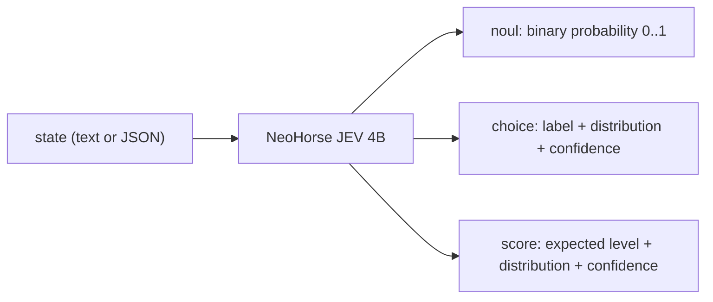

<div align="center">

**English** · [简体中文](docs/readme/README.zh-CN.md)

# neohorse-kit: Production-Grade NeoHorse JEV Decision Toolkit

### Multi-Key Failover · Deterministic LRU Cache · Typed Questions · CLI & Native MCP Server

**Turn NeoHorse JEV into a production decision layer — calibrated probabilities in ~50 ms, zero 401/429 downtime, zero redundant bills.**

[](https://pypi.org/project/neohorse-kit/)
[](https://pypi.org/project/neohorse-kit/)
[](https://modelcontextprotocol.io/)
[](https://agentskills.io)
[](https://github.com/lincong1987/neohorse-kit/actions)
[](LICENSE)

<br />

<code>pip install neohorse-kit</code> &nbsp;·&nbsp; <code>uvx neohorse-kit-mcp</code>

<br /><br />

[Quick Start](#quick-start) · [Architecture & How It Works](#architecture--how-it-works) · [Three Question Types](#three-question-types) · [Image Questions](#image-questions) · [Two Endpoints](#two-endpoints) · [Agent Setup (MCP & Skill)](#agent-setup-mcp--skill) · [FAQ](#faq)

</div>

> [!IMPORTANT]
> **Community Project**: This repository is an independent open-source production-readiness suite and is not affiliated with or endorsed by 基元律动 (Token Rhythm). The NeoHorse JEV decision API is a product of [基元律动 Token Rhythm](https://tokenrhythm.studio) — thanks to the team for providing the free grayscale test model. Install only from official releases on PyPI ([`neohorse-kit`](https://pypi.org/project/neohorse-kit/)) and GitHub ([`lincong1987/neohorse-kit`](https://github.com/lincong1987/neohorse-kit)). API docs: <https://tokenrhythm.studio/docs/api-integration>.

---

## Understand neohorse-kit in 3 Seconds

When agents route tickets, moderate content, triage reports, or take branch actions, chat LLMs are **slow, token-hungry, and their confidence scores are uncalibrated**. A decision model exists precisely for this: [基元律动 Token Rhythm](https://tokenrhythm.studio)'s **NeoHorse JEV 4B** answers structured questions with **calibrated probabilities in ~50 ms** (`decision_seconds` on every response).

**However, running JEV in production or agent loops introduces real operational friction:**

* 🛑 **401 / 403 / 429 crashes**: a key without grayscale access (403), an expired key (401), or a capacity-limited key (429) abruptly halts your agent loop;
* 💸 **Redundant billing & latency**: re-running duplicate tickets or regression suites burns upstream credits and adds hundreds of milliseconds;
* 🧩 **Friction for AI Agents**: hand-writing raw JSON payloads is tedious, and there is no standard MCP/Skill integration;
* 📐 **Silent protocol traps**: 16-question caps, image-implies-one-question, body-size limits — a bare upstream `422 JEV_INVALID_REQUEST` tells you nothing.

**`neohorse-kit` is the production operations layer for JEV:**

* 🔑 **Multi-key pool & zero-downtime failover**: 401/403 (dead key or missing grayscale) and 429 (capacity) hot-swap to the next key mid-request.
* ⚡ **Deterministic LRU cache**: identical requests (same `model` + `state` + `questions` + `image`) are served from memory in microseconds at $0 upstream cost.
* 📦 **1..16 questions in ONE round trip**: batch urgency, severity, routing and risk into a single HTTP payload.
* 🖼️ **Image questions**: attach one PNG per call — pass bytes or a path, the kit builds the data URL and enforces the one-question rule.
* 📐 **Protocol guards**: documented limits are checked client-side with actionable errors before a request is spent.
* 📊 **Per-key metering**: calls / input / output tokens per key, split by each endpoint's own token convention.
* 🤖 **Turnkey MCP server & Agent Skill**: `uvx neohorse-kit-mcp` and `neohorse-kit --install-skill` work out of the box.

---

## Quick Start

### 1. Installation & Environment

```bash
pip install neohorse-kit        # or: uv add neohorse-kit

# Configure a pool of keys (comma-separated; automatically fails over on 401 / 403 / 429)
export NEOHORSE_API_KEYS="sk_tr_prod_1...,sk_tr_prod_2..."
# Or a single key: export NEOHORSE_API_KEY="sk_tr_..."
```

> Get keys from the [Token Rhythm console](https://tokenrhythm.studio). JEV is currently **grayscale-gated**: a key without access gets `403` — keep such a key in the pool anyway, the kit rotates off it instantly.

### 2. Python Usage

```python
from neohorse_kit import NeoHorseClient, presets

# Defaults to NeoHorse-Jev-4B on /v1/decision, loads the NEOHORSE_API_KEYS pool
client = NeoHorseClient()

# ① Binary question -> calibrated probability of YES
res = client.decide("路口信号灯为红色，前方有行人。", presets.urgency())
print(f"Urgency probability: {res.answers['is_urgent'].noul:.4f}")
# e.g. 0.9896

# ② Batch questions on arbitrary JSON state (ONE HTTP roundtrip)
ticket = {
    "ticket_id": "#4096",
    "customer_tier": "Enterprise",
    "title": "Database connection pool exhausted during peak sales",
}
batch = client.decide(ticket, [
    presets.urgency(),      # noul 0..1
    presets.severity(),     # score 0..3 (expected level)
    presets.priority(),     # choice low/medium/high/urgent
])
print("Severity:", batch.answers["severity"].score)      # e.g. 2.78
print("Priority:", batch.answers["priority"].choice)     # e.g. "urgent"
print("Per-key usage:", client.usage)
# {'sk_tr_prod_1…': {'calls': 2, 'input_tokens': 168, 'output_tokens': 0}, ...}
```

> **Async native**: `from neohorse_kit import AsyncNeoHorseClient` — 100% feature parity in async event loops.

### 3. Command Line Interface

```bash
# Default urgency check (clean JSON output)
neohorse-kit "Payment checkout API returning 500 error"

# Noul decision
neohorse-kit "路口信号灯为红色，前方有行人。" --ask "现在是否应停车？" --kind noul

# Choice routing with a full probability distribution
neohorse-kit "I want an immediate refund, you billed me twice!" \
  --ask "What department should handle this?" \
  --kind choice \
  --options billing:"payment, refund, billing issues" technical:"bugs and downtime"

# Score rating
neohorse-kit "I have been waiting for two weeks with no reply. Unacceptable!" \
  --ask "How angry is the customer?" --kind score --levels calm annoyed angry furious

# Image question (one PNG, one question)
neohorse-kit photo.png --image --ask "这张图片里有猫吗？"

# System One compatible response shape
neohorse-kit "TEXT" --endpoint systemone

# Key health check (model catalog)
neohorse-kit --models
```

---

## Architecture & How It Works

`neohorse-kit` sits between your application/agents and the JEV endpoints
(`POST /v1/decision`, `POST /v1/systemone`):

```text
Your code ──► neohorse-kit ──► key pool rotation + retry/backoff ──► https://tokenrhythm.studio/v1
                │
                ├─ LRU cache (sha256 of the full payload)  ── hit? return in µs, $0
                ├─ protocol guards (1..16 questions, image rules, body caps)
                └─ per-key usage metering
```

### Failover & Resilience Matrix

| Error Type | Trigger | neohorse-kit Behavior |
|---|---|---|
| **401** | Invalid or expired platform key | **Instant rotation** to the next key |
| **403** | Key lacks JEV grayscale access | **Instant rotation** to the next key |
| **429** | Capacity rate limit (multi-key pool) | **Instant rotation**, no downtime |
| **429** | Capacity rate limit (single key) | Respects `Retry-After` with exponential backoff & jitter |
| **408 / 5xx / network timeout** | Upstream blip | Exponential backoff + jitter within a 30 s budget, then rotates |
| **413 / 422 / other 4xx** | Body over limit or bad payload | Raises `NeoHorseBadRequest` immediately (no wasteful retries); the platform `traceId` is attached |

Errors carry the platform's `code` / `message` / `traceId` — keep the traceId when filing an issue with Token Rhythm.

### Deterministic Cache

JEV answers are deterministic for identical input, so the kit caches by a
sha256 of the canonical request payload (image data URL included):

```text
First call:     ~800-2000 ms  (upstream round trip + ~50 ms decision; billed once)
Second call:       < 0.1 ms   (memory hit, $0 cost)
```

> Pass `cache_size=0` (Python) or `--no-cache` (CLI) to force fresh calls.

---

## Three Question Types

JEV answers with calibrated probabilities across three question models:



### 1. `noul` — Binary Probability

```python
from neohorse_kit import presets

q = presets.noul("用户是否要求退款？", true="explicit refund request or payment dispute")
res = client.decide("Your tool is completely broken, refund my card right now!", q)
print(res.answers["answer"].noul)          # 0.9821
print(res.answers["answer"].probabilities) # {"false": 0.018, "true": 0.982} on /v1/decision
```

### 2. `choice` — Categorical Classification (1..255 options)

```python
q = presets.choice("What domain does this ticket belong to?", {
    "billing": "Invoices, double charges, payment methods, refunds",
    "technical": "Server 500, bugs, network downtime, crashes",
    "account": "Password reset, email changes, profile settings",
})
res = client.decide("I forgot my password and my registered email is deactivated.", q)
ans = res.answers["answer"]
print(ans.choice)         # "account"
print(ans.confidence)     # 0.9412
print(ans.probabilities)  # {'account': 0.96, 'billing': 0.02, 'technical': 0.02}
```

### 3. `score` — Ordered Level Rating (2..10 levels)

```python
q = presets.score("How angry is the customer?", ["calm", "annoyed", "angry", "furious"])
res = client.decide("This is the third time I am reporting this. Why has nobody fixed it?!", q)
ans = res.answers["answer"]
print(ans.score)      # 1.68 (expected level: between annoyed(1) and angry(2))
print(ans.levels)     # ['calm', 'annoyed', 'angry', 'furious'] (works for list or dict legend)
print(ans.probabilities)  # {'0': 0.05, '1': 0.27, '2': 0.55, '3': 0.13}
```

> [!TIP]
> **Calibrated probabilities are not verdicts**: pick your own thresholds to match your SLA — `noul > 0.85` auto-escalate, `0.50..0.85` human review, `< 0.50` automated handling.

---

## Image Questions

Attach one PNG per call via the top-level `image` field. Pass bytes, a path,
or a ready data URL — the kit converts and validates:

```python
from pathlib import Path
from neohorse_kit import presets

res = client.decide("上传的图片", presets.noul("这张图片里有猫吗？"), image=Path("cat.png"))
print(res.answers["answer"].noul)               # 0.9992
print(res.input_details["image_tokens"])        # 64
```

Rules (enforced client-side before spending a request):

* exactly **one** question when an image is present;
* PNG only, as a base64 data URL;
* body ≤ **1 MiB** without an image, ≤ **8 MiB** with one (image excluded, the rest must still fit 1 MiB);
* no silent truncation — oversized input comes back as `422`.

CLI:

```bash
neohorse-kit photo.png --image --ask "这张图片里有猫吗？"
```

---

## Two Endpoints

Both endpoints take the **same request body**; they differ in the response
shape and token accounting:

| | `POST /v1/decision` (default) | `POST /v1/systemone` |
|---|---|---|
| Answers | same three types; `noul` also carries `probabilities` | same; `choice`/`score` carry `confidence` |
| Tokens | top-level `input_tokens`, falling back to `input_details.expanded_tokens` | `usage.input_tokens` + `usage.output_tokens` (serialized-answer length) |
| Extras | `input_details`, `batch_stats`, `probability_source`, `decision_seconds` | `extensions` (backend, definitions) |

```python
# Per-call override, or construct with endpoint="systemone"
r = client.decide(state, questions, endpoint="systemone")
```

`neohorse-kit` never calls JEV through `/v1/chat/completions` — it is a
decision model, not a chat model.

---

## Agent Setup (MCP & Skill)

### 1. MCP Server

```bash
claude mcp add neohorse uvx neohorse-kit-mcp -e NEOHORSE_API_KEYS=sk_tr_prod_1...,sk_tr_prod_2...
```

Or in any MCP client config (`~/.claude.json`, `.cursor/mcp.json`, Zed settings, ...):

```json
{
  "mcpServers": {
    "neohorse": {
      "command": "uvx",
      "args": ["neohorse-kit-mcp"],
      "env": {"NEOHORSE_API_KEYS": "sk_tr_prod_1...,sk_tr_prod_2..."}
    }
  }
}
```

Tools: `decide` (batch), `ask` (single question), `list_models` (key health check).

### 2. Agent Skill

```bash
npx skills add lincong1987/neohorse-kit   # via skills.sh
# or, with the package installed:
neohorse-kit --install-skill              # ~/.agents/skills/neohorse-kit/SKILL.md
neohorse-kit --install-skill --claude     # ~/.claude/skills/neohorse-kit/SKILL.md
```

---

## FAQ

<details>
<summary><strong>Q: Which model does neohorse-kit call?</strong></summary>

`NeoHorse-Jev-4B`, the only JEV decision model (fixed ID per the platform docs). It does not appear in `GET /v1/models` — that catalog lists chat models, and `neohorse-kit --models` doubles as a key health check.
</details>

<details>
<summary><strong>Q: My key works for chat models but gets 403 on decisions?</strong></summary>

JEV is grayscale-gated: the key needs the JEV permission *and* the account must be on the grayscale list. Keep such keys in the pool — the kit rotates off them instantly, but a single such key will still fail fast with the platform's `traceId`.
</details>

<details>
<summary><strong>Q: Where do I put API keys?</strong></summary>

`NEOHORSE_API_KEYS` (comma-separated) or `NEOHORSE_API_KEY`, or the `env` block of the MCP server config. Never hardcode keys in source code — and never commit them.
</details>

<details>
<summary><strong>Q: Are the probabilities correctness rates?</strong></summary>

No. The docs are explicit: probabilities and `confidence` are **not calibrated correctness rates** (the `systemone` `extensions` even flag the confidence formula as unverified). Treat them as risk measures and set your own thresholds.
</details>

<details>
<summary><strong>Q: What happens when every key is rate-limited?</strong></summary>

The kit cycles the pool, then applies exponential backoff with jitter honouring `Retry-After` within a 30 s budget (default). If nothing recovers, it raises with the last upstream error and its `traceId`.
</details>

---

## Contributing

```bash
git clone https://github.com/lincong1987/neohorse-kit.git
cd neohorse-kit

uv sync
uv run pytest --basetemp=.tmp/pytest   # 100% mocked; no network or keys needed
```

## License

[MIT](LICENSE) © neohorse-kit contributors.
