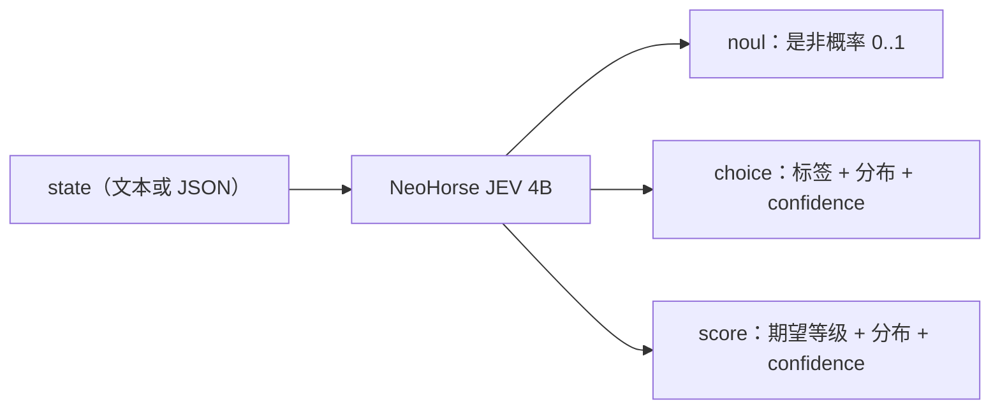

[English](../../README.md) · **简体中文**

# neohorse-kit：生产级 NeoHorse JEV 决策工具箱

### 多密钥故障转移 · 确定性 LRU 缓存 · 题型化封装 · CLI 与原生 MCP Server

**把 NeoHorse JEV 变成生产可用的决策层——约 50ms 决策返回显式概率分数，401/403/429 零停机，重复请求零重复计费。**

[](https://pypi.org/project/neohorse-kit/)
[](https://pypi.org/project/neohorse-kit/)
[](https://modelcontextprotocol.io/)
[](https://agentskills.io)
[](https://github.com/lincong1987/neohorse-kit/actions)
[](../../LICENSE)

<br />

<code>pip install neohorse-kit</code> &nbsp;·&nbsp; <code>uvx neohorse-kit-mcp</code>

<br /><br />

[快速开始](#快速开始) · [架构与原理](#架构与原理) · [三种题型](#三种题型) · [图片题](#图片题) · [双接口](#双接口) · [Agent 接入（MCP 与 Skill）](#agent-接入mcp-与-skill) · [FAQ](#faq)

</div>

> [!IMPORTANT]
> **社区项目**：本仓库是独立的开源生产级工具套件，与基元律动（Token Rhythm）无隶属关系，亦未获其背书。NeoHorse JEV 决策 API 是[基元律动 Token Rhythm](https://tokenrhythm.studio) 的产品——**感谢基元律动提供免费的灰度测试模型**。请只从 PyPI（[`neohorse-kit`](https://pypi.org/project/neohorse-kit/)）与 GitHub（[`lincong1987/neohorse-kit`](https://github.com/lincong1987/neohorse-kit)）安装。接口文档：<https://tokenrhythm.studio/docs/api-integration>。

---

## 三秒看懂 neohorse-kit

Agent 要分流工单、审核内容、定级报告、做分支决策时，聊天大模型**又慢又费 token，它给的置信度也不是真正的概率**。基元律动的 **NeoHorse JEV 4B** 正是为此而生的结构化决策模型：一次请求批量回答最多 16 个问题，约 50ms（`/v1/decision` 响应顶层的 `decision_seconds`）返回**显式的概率分布**。

**但在生产或 Agent 循环里直接用 JEV，有几个真实的运维坑：**

* 🛑 **401 / 403 / 429 打断**：密钥过期（401）、没有灰度权限（403）、容量限流（429）都会让 Agent 循环突然中断；
* 💸 **重复计费与延迟**：重复的工单、回归测试集反复跑，白烧额度还多等几百毫秒；
* 🧩 **Agent 接入麻烦**：手拼 JSON 乏味易错，也没有标准 MCP/Skill 接入方式；
* 📐 **协议陷阱**：16 题上限、带图只能一题、请求体大小限制——上游一句干巴巴的 `422 JEV_INVALID_REQUEST` 什么都不告诉你。

**`neohorse-kit` 就是 JEV 的生产运维层：**

* 🔑 **多密钥池与零停机故障转移**：401/403（死密钥或无灰度权限）和 429（容量限流）在请求内热切换到下一个密钥；
* ⚡ **确定性 LRU 缓存**：相同输入（`model` + `state` + `questions` + `image`）直接命中内存，约 0.1ms 返回、$0 上游成本；
* 📦 **一次往返批量 1..16 题**：紧急度、严重度、路由、风险一个 HTTP 负载全答完；
* 🖼️ **图片题**：每次调用可附一张 PNG——传字节或路径即可，kit 负责转 Data URL 并强制“一题”规则；
* 📐 **协议护栏**：文档化的限制在花费请求之前本地校验，报错带可执行信息；
* 📊 **分密钥计量**：按密钥统计调用次数 / 输入 / 输出 token，遵循两种接口各自的 token 口径；
* 🤖 **开箱即用的 MCP Server 与 Agent Skill**：`uvx neohorse-kit-mcp`、`neohorse-kit --install-skill`。

---

## 快速开始

### 1. 安装与环境

```bash
pip install neohorse-kit        # 或：uv add neohorse-kit

# 配置密钥池（逗号分隔；401 / 403 / 429 自动故障转移）
export NEOHORSE_API_KEYS="sk_tr_prod_1...,sk_tr_prod_2..."
# 单密钥：export NEOHORSE_API_KEY="sk_tr_..."
```

> 密钥在 [Token Rhythm 控制台](https://tokenrhythm.studio) 创建。JEV 目前**灰度放行**：没有权限的密钥会得到 `403`——这样的密钥也可以放在池子里，kit 会瞬间切走。

### 2. Python 用法

```python
from neohorse_kit import NeoHorseClient, presets

# 默认 NeoHorse-Jev-4B + /v1/decision，自动读取 NEOHORSE_API_KEYS 池
client = NeoHorseClient()

# ① 是非题 -> “是”的概率（0..1）
res = client.decide("路口信号灯为红色，前方有行人。", presets.urgency())
print(f"紧急度概率: {res.answers['is_urgent'].noul:.4f}")   # 例如 0.9896

# ② 任意 JSON state 上批量出题（一次 HTTP 往返）
ticket = {
    "ticket_id": "#4096",
    "customer_tier": "Enterprise",
    "title": "大促期间数据库连接池耗尽",
}
batch = client.decide(ticket, [
    presets.urgency(),      # noul 0..1
    presets.severity(),     # score 0..3（期望等级）
    presets.priority(),     # choice low/medium/high/urgent
])
print("严重度:", batch.answers["severity"].score)      # 例如 2.78
print("优先级:", batch.answers["priority"].choice)     # 例如 "urgent"
print("分密钥用量:", client.usage)
# {'sk_tr_prod_1…': {'calls': 2, 'input_tokens': 168, 'output_tokens': 0}, ...}
```

> **异步原生**：`from neohorse_kit import AsyncNeoHorseClient`，异步事件循环内 100% 功能对齐。

### 3. 命令行

```bash
# 默认紧急度判断（干净 JSON 输出）
neohorse-kit "Payment checkout API returning 500 error"

# 是非决策
neohorse-kit "路口信号灯为红色，前方有行人。" --ask "现在是否应停车？" --kind noul

# 路由分类（带完整概率分布）
neohorse-kit "我要立即退款，你们重复扣费了！" \
  --ask "应该由哪个部门处理？" \
  --kind choice \
  --options billing:"支付、退款、账单问题" technical:"故障与宕机"

# 等级评分
neohorse-kit "等了两周没人回复，不可接受！" \
  --ask "客户有多愤怒？" --kind score --levels calm annoyed angry furious

# 图片题（一张 PNG，一道题）
neohorse-kit photo.png --image --ask "这张图片里有猫吗？"

# System One 兼容响应格式
neohorse-kit "TEXT" --endpoint systemone

# 密钥健康检查（模型目录）
neohorse-kit --models
```

---

## 架构与原理

`neohorse-kit` 夹在你的应用/Agent 与 JEV 接口（`POST /v1/decision`、`POST /v1/systemone`）之间：

```text
你的代码 ──► neohorse-kit ──► 密钥轮换 + 重试退避 ──► https://tokenrhythm.studio/v1
                │
                ├─ LRU 缓存（整个 payload 的 sha256）── 命中？≈0.1ms 返回，$0
                ├─ 协议护栏（1..16 题、带图一题、请求体上限）
                └─ 分密钥用量计量
```

### 故障转移与韧性矩阵

| 错误类型 | 触发条件 | neohorse-kit 行为 |
|---|---|---|
| **401** | 平台密钥无效或过期 | **立即轮换**到下一个密钥 |
| **403** | 密钥没有 JEV 灰度权限 | **立即轮换**到下一个密钥 |
| **429** | 容量限流（多密钥池） | **立即轮换**，零停机 |
| **429** | 容量限流（单密钥） | 尊重 `Retry-After`，指数退避 + 抖动 |
| **408 / 5xx / 网络超时** | 上游抖动 | 30 秒预算内指数退避 + 抖动，然后轮换 |
| **413 / 422 / 其他 4xx** | 请求体超限或参数错误 | 立即抛 `NeoHorseBadRequest`（不浪费重试），并附带平台 `traceId` |

异常对象携带平台的 `code` / `message` / `traceId`——向 Token Rhythm 反馈问题时请保留 traceId。

### 确定性缓存

JEV 对相同输入的回答是确定性的，因此 kit 以规范化请求体（含图片 Data URL）的 sha256 为键做缓存：

```text
首次调用：   ~300-400 ms（网络往返 + ~50 ms 决策；计费一次）
缓存命中：      ≈ 0.1 ms（内存命中，$0）
```

> 需要强制走网络时：Python 传 `cache_size=0`，CLI 加 `--no-cache`。

---

## 三种题型

JEV 用显式的概率分布回答三类问题：



### 1. `noul` — 是非概率

```python
from neohorse_kit import presets

q = presets.noul("用户是否要求退款？", true="明确的退款请求或支付争议")
res = client.decide("你们的工具根本没法用，马上退钱！", q)
print(res.answers["answer"].noul)          # 0.9821
print(res.answers["answer"].probabilities) # /v1/decision 上另有 {"false": 0.018, "true": 0.982}
```

### 2. `choice` — 分类路由（1..255 个选项）

```python
q = presets.choice("这条工单属于哪个领域？", {
    "billing": "发票、重复扣费、支付方式、退款",
    "technical": "500 错误、bug、网络中断、崩溃",
    "account": "密码重置、邮箱变更、资料设置",
})
res = client.decide("我忘了密码，注册邮箱也停用了。", q)
ans = res.answers["answer"]
print(ans.choice)         # "account"
print(ans.confidence)     # 0.9412
print(ans.probabilities)  # {'account': 0.96, 'billing': 0.02, 'technical': 0.02}
```

### 3. `score` — 有序等级评分（2..10 档）

```python
q = presets.score("客户有多愤怒？", ["平静", "不满", "生气", "暴怒"])
res = client.decide("这是我第三次反馈了，到底有没有人管？！", q)
ans = res.answers["answer"]
print(ans.score)      # 1.68（期望等级：介于 不满(1) 与 生气(2) 之间）
print(ans.levels)     # ['平静', '不满', '生气', '暴怒']（legend 是列表或字典都能用）
print(ans.probabilities)  # {'0': 0.05, '1': 0.27, '2': 0.55, '3': 0.13}
```

> [!TIP]
> **概率不是判决书，也不是正确率**：平台文档明确说明这些分数和 `confidence` **不是**校准过的正确率。按自己的 SLA 设阈值——`noul > 0.85` 自动升级，`0.50..0.85` 转人工，`< 0.50` 自动处理。

---

## 图片题

每次调用可通过顶层 `image` 字段附一张 PNG。传字节、路径或现成的 Data URL，kit 负责转换与校验：

```python
from pathlib import Path
from neohorse_kit import presets

res = client.decide("上传的图片", presets.noul("这张图片里有猫吗？"), image=Path("cat.png"))
print(res.answers["answer"].noul)         # 0.9992
print(res.input_details["image_tokens"])  # 64
```

规则（花费请求前本地强制）：

* 带图时**只能有一道题**；
* 仅 PNG，base64 Data URL；
* 请求体无图 ≤ **1 MiB**，带图 ≤ **8 MiB**（去掉图片后其余部分仍须 ≤ 1 MiB）；
* 不做静默截断——超限上游返回 `422`。

CLI：

```bash
neohorse-kit photo.png --image --ask "这张图片里有猫吗？"
```

---

## 双接口

两个接口**请求体完全相同**，差别在响应结构与 token 口径：

| | `POST /v1/decision`（默认） | `POST /v1/systemone` |
|---|---|---|
| 答案 | 三类题型一致；`noul` 额外带 `probabilities` | 三类题型一致；`choice`/`score` 带 `confidence` |
| Token | 顶层 `input_tokens`，缺失时回退 `input_details.expanded_tokens` | `usage.input_tokens` + `usage.output_tokens`（答案为序列化长度，非生成 token） |
| 附加 | `input_details`、`batch_stats`、`probability_source`、`decision_seconds` | `extensions`（后端、口径说明） |

```python
# 单次覆盖，或构造时传 endpoint="systemone"
r = client.decide(state, questions, endpoint="systemone")
```

`neohorse-kit` 绝不会通过 `/v1/chat/completions` 调用 JEV——它是决策模型，不是聊天模型。

---

## Agent 接入（MCP 与 Skill）

### 1. MCP Server

```bash
claude mcp add neohorse uvx neohorse-kit-mcp -e NEOHORSE_API_KEYS=sk_tr_prod_1...,sk_tr_prod_2...
```

或在任意 MCP 客户端配置里（`~/.claude.json`、`.cursor/mcp.json`、Zed settings 等）：

```json
{
  "mcpServers": {
    "neohorse": {
      "command": "uvx",
      "args": ["neohorse-kit-mcp"],
      "env": {"NEOHORSE_API_KEYS": "sk_tr_prod_1...,sk_tr_prod_2..."}
    }
  }
}
```

工具：`decide`（批量）、`ask`（单题）、`list_models`（密钥健康检查）。

### 2. Agent Skill

```bash
npx skills add lincong1987/neohorse-kit   # 经 skills.sh
# 或已安装本包：
neohorse-kit --install-skill              # ~/.agents/skills/neohorse-kit/SKILL.md
neohorse-kit --install-skill --claude     # ~/.claude/skills/neohorse-kit/SKILL.md
```

---

## FAQ

<details>
<summary><strong>Q：neohorse-kit 调用哪个模型？</strong></summary>

`NeoHorse-Jev-4B`，平台文档固定的唯一 JEV 决策模型 ID。它不出现在 `GET /v1/models` 里——那是聊天模型目录，`neohorse-kit --models` 仅用作密钥健康检查。
</details>

<details>
<summary><strong>Q：密钥能调聊天模型，决策却返回 403？</strong></summary>

JEV 走灰度名单：密钥要有 JEV 权限，账号也要在灰度名单里。把这类密钥留在池子里即可——kit 会瞬间切走；但只有一个这类密钥时仍会快速失败，并带上平台的 `traceId`。
</details>

<details>
<summary><strong>Q：密钥放哪里？</strong></summary>

`NEOHORSE_API_KEYS`（逗号分隔）或 `NEOHORSE_API_KEY`，或 MCP Server 配置的 `env` 块。永远不要硬编码进源码，更不要提交进 git。
</details>

<details>
<summary><strong>Q：概率是正确率吗？</strong></summary>

不是。文档明确说明概率与 `confidence` **不是经过校准的正确率**（`systemone` 的 `extensions` 甚至标注置信度公式未经类型安全验证）。把它们当风险度量，阈值自己定。
</details>

<details>
<summary><strong>Q：所有密钥都被限流会怎样？</strong></summary>

kit 先轮换整个密钥池，再按 `Retry-After` 做带抖动的指数退避（默认 30 秒预算）。仍不可用则抛出最后一个上游错误及其 `traceId`。
</details>

---

## 参与贡献

```bash
git clone https://github.com/lincong1987/neohorse-kit.git
cd neohorse-kit

uv sync
uv run pytest --basetemp=.tmp/pytest   # 全程 mock，无需网络与密钥
```

## 许可证

[MIT](../../LICENSE) © neohorse-kit contributors.
